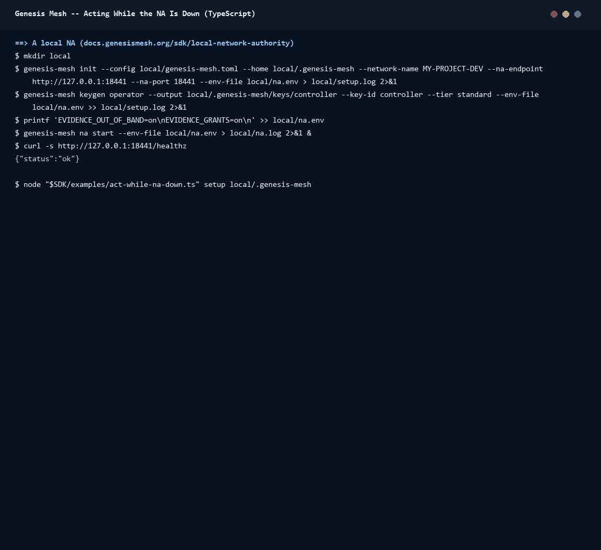

# Walkthrough: acting while the NA is down

A device at an edge site must rotate a key while it cannot reach the Network
Authority (NA). This walkthrough runs that case against a local NA:

1. With the NA up, the privileged key issues a grant for two rotations.
2. The NA stops.
3. The device rotates twice under the grant. Each use is signed and kept in the record outbox.
4. A third rotation is past the grant's budget. It falls back to break-glass.
5. The NA starts again.
6. `holder.sync()` uploads everything.
7. `resourceChanges` shows the two uses and the judged break-glass record.

The script is [`examples/act-while-na-down.ts`](../../examples/act-while-na-down.ts).
It runs in three phases, `setup`, `act` and `sync`, and the NA is stopped and
started between them. It follows the grants block of the live test
(`tests/e2e.test.ts`). Grants and break-glass are described in
[Pre-issued grants](../grants.md) and
[Changes outside the controlled path](../out-of-band-changes.md).



## Run it

Set up a local NA as in
[Develop Against a Local Network Authority](https://docs.genesismesh.org/sdk/local-network-authority.html)
(`genesis-mesh` 1.7 or later), and turn on the two features this needs
before you start it. Grant routes are beta.

```bash
printf 'EVIDENCE_OUT_OF_BAND=on\nEVIDENCE_GRANTS=on\n' >> local/na.env
genesis-mesh na start --env-file local/na.env
```

In a checkout of this repository (Node.js 22.18 or later):

```bash
npm ci && npm run build
export GM_NA_URL=http://127.0.0.1:9443
node examples/act-while-na-down.ts setup local/.genesis-mesh   # the NA is up
# stop the NA
node examples/act-while-na-down.ts act local/.genesis-mesh     # the NA is down
# start the NA again
node examples/act-while-na-down.ts sync local/.genesis-mesh
```

The device keeps its state and its record outbox in `local/device/`. Run
`setup` again to start over with a new grant.

## What it does

**`setup` (NA up, privileged key).** The script:

- issues an attestation and activates a policy whose `lifetime` gate allows at most 90 days;
- registers the device's bearer key as an executor key;
- asks for a grant with `gm.grants.issueGrant`: `secret.rotate`, `max_uses: 2`, 30 minutes, and an envelope that allows `lifetime_days` from 1 to 60. The NA checks the envelope against every policy that applies; an envelope a gate could deny is refused (`grant_gate_may_deny`).

The device saves the grant, its first time token and the NA keys, verified
from the root key. It also saves the policy and the attestation, which the
break-glass fallback verifies a decision against.

**`act` (NA down).** A `GrantHolder` resumes from the saved state, with the
controller's standard key and a `FileRecordOutbox`.

- Uses 1 and 2: `holder.act` checks everything offline: the capability, the envelope, the budget, the validity and the time token. It then runs the action, signs the use with the bearer key and keeps it in the record outbox as `pending`.
- Use 3: the holder's budget is spent (`grant_budget_exhausted`). With `fallback`, `act` goes through `governedAction` with break-glass. The evaluation cannot reach the NA, so the action runs and a signed `BreakGlassRecord` waits in the outbox.

A DENY is never broken through. Had the NA answered, it would have decided
the third rotation itself.

**`sync` (NA up again).** `holder.sync()` reads the revocation feed, asks for
a fresh time token and flushes the record outbox (`evidenceStore.flushRecords`).
Break-glass records go first, then the grant's uses in the order they were
made. That is why the break-glass record has the lower store position.
Afterwards, the NA reports the grant `exhausted`: 2 uses, none left.

`resourceChanges` then lists the resource's changes:

- each use is governed by the `grant`, `recorded`;
- the break-glass record is governed `after_the_fact`. The NA judged it at admission against the policy (`judged_allowed`, verdict `allow`). A judgement is never an approval.

## Record the GIF again

[`docs/assets/walkthroughs/record.sh`](../assets/walkthroughs/record.sh) runs the NA in
a temporary directory, stops it with `kill` and starts it again between the
phases.
[`acting-while-the-na-is-down.txt`](../assets/walkthroughs/acting-while-the-na-is-down.txt)
is the session the GIF was rendered from.

```bash
npm run build
PORT=9443 docs/assets/walkthroughs/record.sh acting-while-the-na-is-down > acting-while-the-na-is-down.txt
```

## Next

- [Pre-issued grants](../grants.md): issuing, holding, the budget, revocation and verification.
- [Changes outside the controlled path](../out-of-band-changes.md): the record outbox, break-glass and judgements.
- [A governed rotation](governed-rotation.md): the same rotation with the NA up.
