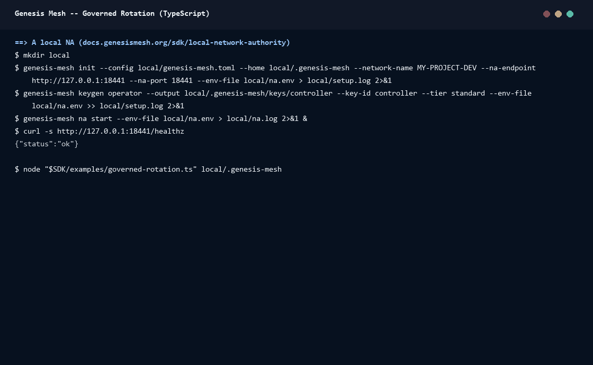

# Walkthrough: a governed rotation

This walkthrough runs one secret rotation end to end against a Network
Authority (NA) on your machine:

1. Set up with the privileged key: an attestation, a policy and an executor key.
2. Run `governedAction` with the controller's standard key and an evidence outbox: one ALLOW and one DENY.
3. Check the outbox.
4. Export the evidence store and verify it offline, from the root key.

The script is [`examples/governed-rotation.ts`](../../examples/governed-rotation.ts).
It is built on the setup of the live test (`tests/e2e.test.ts`). The cloud
call is a stub: only metadata enters the evidence.



## Run it

You need Node.js 22.18 or later, which runs TypeScript directly, and
`genesis-mesh` 1.7 or later. Start a local NA as
[Develop Against a Local Network Authority](https://docs.genesismesh.org/sdk/local-network-authority.html)
describes:

```bash
genesis-mesh init --config local/genesis-mesh.toml --home local/.genesis-mesh \
    --network-name MY-PROJECT-DEV --na-endpoint http://127.0.0.1:9443 \
    --na-port 9443 --env-file local/na.env
genesis-mesh keygen operator --output local/.genesis-mesh/keys/controller \
    --key-id controller --tier standard --env-file local/na.env
genesis-mesh na start --env-file local/na.env
```

In a checkout of this repository, build the SDK and run the script. Pass the
NA's home directory:

```bash
npm ci && npm run build
GM_NA_URL=http://127.0.0.1:9443 node examples/governed-rotation.ts local/.genesis-mesh
```

Every run uses new IDs, so you can run it again against the same NA.

## What it does

**Setup, with the privileged key (`operator-local`).** The script:

- issues an attestation to the controller's subject, with the claims `capabilities: ['secret.rotate']` and `apps: ['app-1']`;
- publishes and activates a policy for `secret.rotate` with two enforced gates: `app_id` must be one of the attestation's `apps`, and `lifetime_days` must be at most 90;
- registers a new executor key.

The standard key cannot do any of this: the NA answers
`403 insufficient_operator_tier`.

**The controller, with the standard key (`controller`).** The client has a
`FileOutbox`. Before the controller acts, it reads the NA's key history and
verifies it from the root public key (`gm.na.verifiedKeyHistory(rootKey)`). In
production the root key is held outside the NA; here it is read from
`keys/root.pub`.

`governedAction` evaluates each request, verifies the signed decision against
that history, the expected policy and the expected attestation, and only
then runs the callback:

- `lifetime_days: 30` is an ALLOW. The callback runs, and the signed execution evidence is submitted and recorded.
- `lifetime_days: 400` is a DENY from the `lifetime` gate. The callback never runs, and no evidence is submitted.

**The outbox.** `governedAction` writes each record to the outbox before it
submits it, and removes it once the NA admits it. With the NA up, the outbox
is empty after the action, and `flushPending()` has nothing to do. When the
NA cannot be reached, the record stays `pending` until `flushPending()`
submits it. See [Governed SDK actions](../governance.md#evidence-outbox).

**Offline verification.** The script reads the store with `exportText` and
parses it with `parseExportLines`. `verifyEvidenceEvents` then checks every
entry against the verified key history and the registered executor keys:
the policy, the attestation, both decisions and the execution record.

## Record the GIF again

[`docs/assets/walkthroughs/record.sh`](../assets/walkthroughs/record.sh) starts a fresh
NA in a temporary directory, runs the steps above and prints the session.
[`governed-rotation.txt`](../assets/walkthroughs/governed-rotation.txt) is the session
the GIF was rendered from.

```bash
npm run build
PORT=9443 docs/assets/walkthroughs/record.sh governed-rotation > governed-rotation.txt
```

## Next

- [Acting while the NA is down](acting-while-the-na-is-down.md): a pre-issued grant, then break-glass.
- [Governed SDK actions](../governance.md): every option of `governedAction`, the outbox and reconciliation.
- [Offline verification](../offline-verification.md): what the verifiers check.
